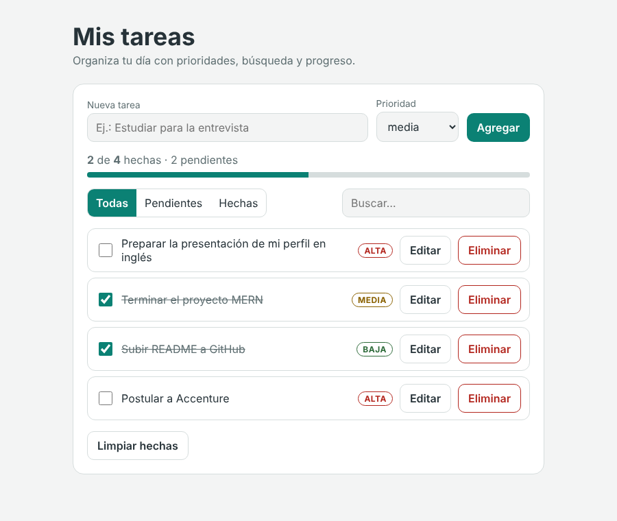
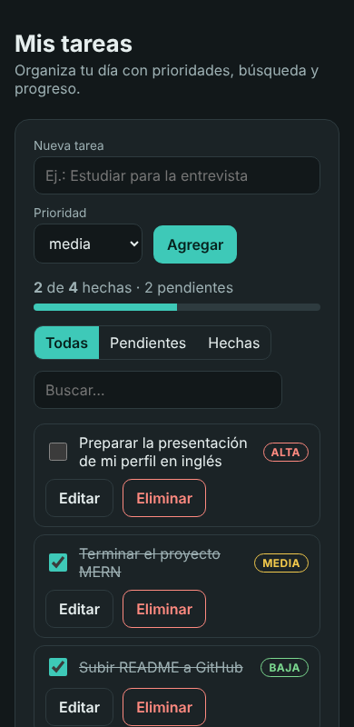
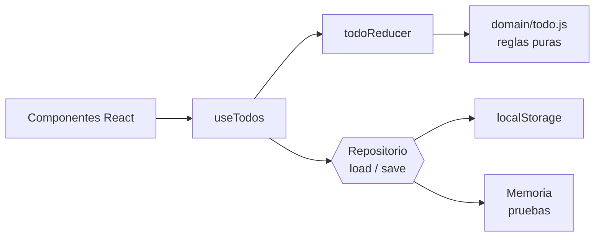

# ✅ Todo App: gestor de tareas con React

[](https://github.com/zulnidi/todo_app_react/actions/workflows/ci.yml)

Gestor de tareas con prioridades, búsqueda, filtros, edición, deshacer y progreso. Pensado como ejemplo de un frontend React **limpio, probado y accesible**.

> **English summary:** a task manager built with React 19 and Vite. Business rules live in pure functions, state in a reducer, and persistence behind an injectable repository (dependency inversion), so everything is unit-testable. 30 tests, accessible UI (labels, keyboard, `aria-live`), light/dark theme and CI.

| Escritorio                                  | Móvil (modo oscuro)                               |
| ------------------------------------------- | ------------------------------------------------- |
|  |  |

## ✨ Qué hace

- Agregar tareas con prioridad (alta, media, baja) y validación (vacío, máximo 120 caracteres).
- Marcar como hecha, editar en línea y eliminar con **deshacer**.
- Filtrar (todas, pendientes, hechas), buscar por texto y ver el porcentaje de progreso.
- Guardar en el navegador (`localStorage`) y tolerar datos corruptos o almacenamiento no disponible.
- Tema claro/oscuro automático y diseño responsive.

## 🧱 Arquitectura



| Capa         | Archivo                                                          | Responsabilidad                                                            |
| ------------ | ---------------------------------------------------------------- | -------------------------------------------------------------------------- |
| Dominio      | [`src/domain/todo.js`](src/domain/todo.js)                       | Validar, crear, filtrar y calcular estadísticas (funciones puras)          |
| Estado       | [`src/state/todoReducer.js`](src/state/todoReducer.js)           | Transiciones de estado y deshacer                                          |
| Persistencia | [`src/storage/todoRepository.js`](src/storage/todoRepository.js) | Repositorio `localStorage` y repositorio en memoria                        |
| Hook         | [`src/hooks/useTodos.js`](src/hooks/useTodos.js)                 | Une reducer y repositorio                                                  |
| UI           | [`src/components/`](src/components)                              | Componentes pequeños y reutilizables (`Button`, `TodoForm`, `TodoItem`...) |

### Decisiones de diseño

- **Responsabilidad única:** las reglas de negocio no saben nada de React; los componentes no saben cómo se guarda.
- **Inversión de dependencias:** `TodoApp` recibe un `repository` por props. En producción es `localStorage` ([`App.jsx`](src/App.jsx)); en las pruebas es un repositorio en memoria.
- **Abierto/cerrado:** para guardar en una API basta con crear otro repositorio con `load` y `save`; nada más cambia.
- **Reutilización:** un único `Button` con variantes, y creadores de acciones (`actions.add`, `actions.toggle`...) para no repetir la forma de las acciones.

## 🛠️ Stack

React 19 · Vite 7 · Vitest + Testing Library · ESLint · Prettier · GitHub Actions

## 🚀 Cómo ejecutarlo

```bash
npm install
npm run dev        # http://localhost:5173
```

## 🧪 Pruebas y calidad

```bash
npm test           # 30 pruebas
npm run coverage   # informe de cobertura
npm run lint
npm run format:check
npm run build
```

Cubren las reglas de dominio, el reducer (incluido deshacer), el repositorio (JSON corrupto, almacenamiento que falla) y la app completa con Testing Library (agregar, validar, filtrar, editar, eliminar/deshacer, persistir).

La integración continua ejecuta lint, formato, cobertura y build en cada push ([`ci.yml`](.github/workflows/ci.yml)).

## 🌐 Despliegue

El workflow [`deploy.yml`](.github/workflows/deploy.yml) publica en GitHub Pages. Para activarlo: **Settings → Pages → Source: GitHub Actions**. La app quedará en `https://zulnidi.github.io/todo_app_react/`.

## 📁 Estructura

```
src/
├── domain/       # reglas puras + pruebas
├── state/        # reducer + pruebas
├── storage/      # repositorios + pruebas
├── hooks/        # useTodos
├── components/   # UI + prueba de integración
└── test/         # configuración de pruebas
```

## 🔮 Próximos pasos

- Fechas de vencimiento y orden por prioridad.
- Repositorio que sincronice con una API.

## 👩‍💻 Autora

**Zullie Nicole Díaz López**: [GitHub](https://github.com/zulnidi)
